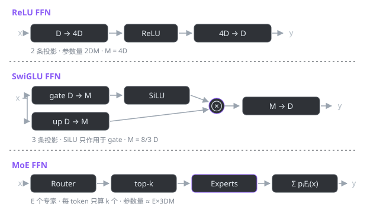

<div align="center">

# HESUmind

**LLM 学习教程 · 从零手搓大模型组件**

<sub>不调 API，不跑现成模型，把 Transformer 拆成零件一个一个写出来。</sub>

<br />

[](https://www.python.org/)
[](https://pytorch.org/)
[](tutorial/README.md)
[](tutorial/README.md)
[](https://github.com/Chuming000/HESUmind/stargazers)

</div>

---

## 这是什么

一个手写 LLM 组件的学习仓库。每个组件都包含**可独立运行的实现** + **配套教程**，教程覆盖：原理推导、逐行代码、实测输出、易错点、大厂面试题、相关论文。

写这个仓库的动机很直接——模型的参数量、显存占用、推理速度、训练稳定性，全都藏在这些组件的细节里。手写过一次 RMSNorm，才会明白 LLaMA 为什么敢把均值中心化砍掉；手写过一次 MoE，才知道「总参数 46.7B、每 token 只算 12.9B」背后省在哪。

## 目录

| 模块 | 组件 | 代码 | 教程 | 状态 |
| :-- | :-- | :-- | :-- | :--: |
| 归一化 | LayerNorm / RMSNorm | [`norm/rms_norm.py`](norm/rms_norm.py) | [01 · 归一化层](tutorial/01-normalization.md) | ✅ |
| 前馈网络 | ReLU FFN | [`FFN/ffn.py`](FFN/ffn.py) | [02 · ReLU FFN](tutorial/02-ffn-relu.md) | ✅ |
| 前馈网络 | SwiGLU FFN | [`FFN/ffn.py`](FFN/ffn.py) | [03 · SwiGLU FFN](tutorial/03-ffn-swiglu.md) | ✅ |
| 前馈网络 | MoE FFN | [`FFN/ffn.py`](FFN/ffn.py) | [04 · MoE FFN](tutorial/04-ffn-moe.md) | ✅ |
| 优化器 | AdamW / Muon | `optimizer/` | — | 🚧 |
| 注意力 | MHA → GQA → MLA | `attention/` | — | ⏳ |
| 位置编码 | RoPE | `position/` | — | ⏳ |

> 完整导读见 **[tutorial/README.md](tutorial/README.md)**

## 一张图

<div align="center">



</div>

同样是「升维 → 非线性 → 降维」，三种写法在参数效率和表达能力上做了不同取舍：

| | 投影数 | 中间维度 | 参数量（D=512） | 每 token 激活 |
| :-- | --: | --: | --: | --: |
| ReLU FFN | 2 | 4D = 2048 | 2,099,712 | 100% |
| SwiGLU FFN | 3 | 8/3D → 1536 | 2,359,296 | 100% |
| MoE FFN（8 专家 top-2） | 3×8 + router | 1536 | 18,878,464 | 25.0% |

## 快速开始

```bash
git clone https://github.com/Chuming000/HESUmind.git
cd HESUmind

pip install torch          # CPU 版即可，所有示例都不需要 GPU

python norm/rms_norm.py    # 归一化对比
python FFN/ffn.py          # 三种 FFN 的参数量与稀疏性
```

> Windows 下如果中文输出乱码：PowerShell 执行 `$env:PYTHONIOENCODING='utf-8'`。
> 本仓库实测环境：`torch 2.13.0+cpu` / `Python 3.14.6`。

## 学习路线

```
归一化 (RMSNorm)  →  FFN (ReLU → SwiGLU → MoE)  →  注意力 (MHA/GQA/MLA)  →  位置编码 (RoPE)  →  组装完整模型
     ✅ 已完成               ✅ 已完成                     ⏳ 计划中             ⏳ 计划中         ⏳ 计划中
```

每一章的固定结构：

| 环节 | 内容 |
| :-- | :-- |
| 发展历程 | 组件从哪来、为什么被淘汰/被采用，配时间线表 |
| 原理 | 数学定义与直觉解释 |
| 实现 | 逐行讲解，标出每个细节为什么这么写 |
| 实测 | 真实运行输出 + 手算核对 |
| 易错点 | 踩过的坑与隐蔽 bug |
| 面试题 | 大模型岗高频问题与回答要点 |
| 论文 | 原始论文与延伸阅读 |

## 参考

- [datawhalechina/self-llm](https://github.com/datawhalechina/self-llm) —— 章节组织与行文风格参考
- [卡码笔记 · 大模型专栏](https://notes.kamacoder.com/llm/transformer/modern_llm_improvements.html) —— 面试题组织方式参考
- 各章末尾的论文列表

<div align="center">
<sub>如果这个仓库对你有帮助，点个 ⭐ 就是最大的鼓励</sub>
</div>
