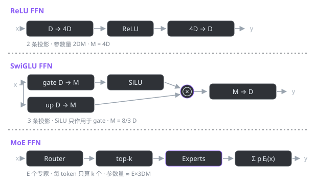

# HESUmind · LLM 组件手搓教程

> 从零开始，把一个大模型拆成零件，一个一个用 PyTorch 写出来。
> 每个组件都配：**原理推导 → 逐行代码 → 实测输出 → 踩坑记录 → 真实模型对照**。

---

## 这套教程怎么读

市面上的 LLM 教程大多停在「调 API」和「跑通一个开源模型」。这个仓库走另一条路：**不看别人的实现，自己把组件写一遍**。

理由很简单——模型的参数量、显存占用、推理速度、训练稳定性，全都藏在这些组件的细节里。你手写过一次 RMSNorm，才会明白为什么 LLaMA 敢把 LayerNorm 的均值中心化砍掉；你手写过一次 MoE，才知道「总参数 46.7B、每 token 只算 12.9B」这句话背后到底省在哪。

每一章的结构是固定的：

| 环节 | 你会得到什么 |
| :-- | :-- |
| 原理 | 这个组件解决什么问题，数学定义是什么 |
| 实现 | 可以独立运行的 `.py` 文件，逐行注释 |
| 实测 | 真实运行输出，不是编的 |
| 坑 | 我写的时候踩过、或者差点踩到的地方 |
| 对照 | 真实模型（LLaMA-2、Mixtral 等）里的超参是怎么定的 |

---

## 目录

### 归一化

| 章节 | 内容 | 代码 |
| :-- | :-- | :-- |
| [01 · LayerNorm 与 RMSNorm](01-normalization.md) | 均值中心化到底要不要？FP16 下为什么要先转 FP32 | [`norm/rms_norm.py`](../norm/rms_norm.py) |

### 前馈网络（FFN）

| 章节 | 内容 | 代码 |
| :-- | :-- | :-- |
| [02 · ReLU FFN](02-ffn-relu.md) | 最经典的升维-激活-降维，以及 4D 惯例从哪来 | [`FFN/ffn.py`](../FFN/ffn.py) |
| [03 · SwiGLU FFN](03-ffn-swiglu.md) | 门控怎么加，为什么中间维度是 8/3 D 而不是 4D | [`FFN/ffn.py`](../FFN/ffn.py) |
| [04 · MoE FFN](04-ffn-moe.md) | 稀疏激活、top-k 路由、负载均衡损失 | [`FFN/ffn.py`](../FFN/ffn.py) |

### 待补充

- 优化器：AdamW、Muon
- 注意力：MHA → GQA → MLA
- 位置编码：RoPE
- 完整模型组装

---

## 环境

```bash
python >= 3.10
torch >= 2.0        # CPU 即可，所有示例都不需要 GPU
```

运行任意章节的示例：

```bash
python norm/rms_norm.py
python FFN/ffn.py
```

> Windows 用户如果看到中文输出乱码，先 `set PYTHONIOENCODING=utf-8`（PowerShell：`$env:PYTHONIOENCODING='utf-8'`）。

本仓库实测输出所用的版本：`torch 2.13.0+cpu` / `Python 3.14.6`。

---

## 一张图看懂三种 FFN



同样是「升维 → 非线性 → 降维」这件事，三种写法在参数效率和表达能力上做了不同的取舍：

| | 投影数 | 中间维度 | 参数量（D=512） | 每 token 激活 |
| :-- | --: | --: | --: | --: |
| ReLU FFN | 2 | 4D = 2048 | 2,099,712 | 100% |
| SwiGLU FFN | 3 | 8/3 D → 1536 | 2,359,296 | 100% |
| MoE FFN（8 专家 top-2） | 3 × 8 + router | 1536 | 18,878,464 | 25.0% |

---

## 参考

- [datawhalechina/self-llm](https://github.com/datawhalechina/self-llm) —— 本教程的章节组织和行文风格参考
- [LLaMA-2 论文](https://arxiv.org/abs/2307.09288) —— RMSNorm、SwiGLU、11008 的出处
- [Root Mean Square Layer Normalization](https://arxiv.org/abs/1910.07467) —— RMSNorm 原始论文
- [GLU Variants Improve Transformer](https://arxiv.org/abs/2002.05202) —— SwiGLU
- [Mixtral of Experts](https://arxiv.org/abs/2401.04088) —— MoE 的工程实践
- [Switch Transformers](https://arxiv.org/abs/2101.03961) —— 负载均衡损失
